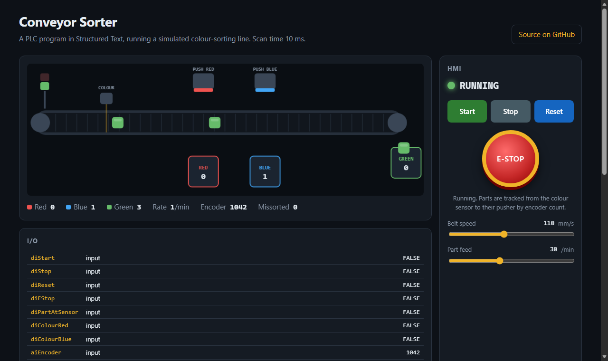

# Conveyor Sorter


A colour-sorting conveyor controlled by a PLC program written in **Structured Text** (IEC 61131-3) for B&R Automation Studio, with a browser simulator that runs the same logic.

**[Try the simulator](https://jhleez1.github.io/conveyor-sorter/)**



## What it does

Parts arrive on a belt in three colours. A colour sensor identifies each one, and two pneumatic pushers knock red and blue parts into their bins. Green parts ride to the end of the belt.

- **State machine:** `IDLE → RUNNING → FAULT`, driven by Start, Stop, Reset and E-STOP.
- **Encoder tracking:** the pushers are some distance down the belt from the sensor, so the program can't just fire a pusher when it sees a colour. When a part passes the sensor, the program stores *encoder now + distance to the pusher* in a ring buffer. When the encoder reaches that number, the part is in front of the pusher. Speed changes and stops don't break it, because the target is a belt position, not a time.
- **E-STOP latches:** releasing the button is not enough. The operator must also press Reset, and the line does not restart by itself. The tracking queues are cleared, because parts may have been moved by hand.
- **Ring buffers:** PLCs avoid dynamic memory, so each pusher has a fixed `ARRAY[0..15] OF DINT` queue with head and count indices. If it fills up, the program counts a dropped part instead of overwriting data.

## Files

| Path | What it is |
| --- | --- |
| `src/ConveyorSorter/Cyclic.st` | The PLC program (runs every cycle) |
| `src/ConveyorSorter/Init.st` | Start-up code |
| `src/ConveyorSorter/Variables.var` | I/O, constants and internal variables |
| `plc.js` | The same logic ported line for line to JavaScript, so the browser can run it |
| `sim.js` | The "machine": belt physics, sensors, pushers, drawing and the HMI |
| `test/plc.test.js` | Tests for the logic: tracking, ordering, E-STOP latch, full queues |

## Run it

Open `index.html` in a browser. To see the ST source inside the page, serve the folder, for example with `python -m http.server`.

Tests need Node 18 or newer:

```
node --test
```

## Using it on a real PLC

Add the three files under `src/ConveyorSorter` to a program in Automation Studio, then map the `di*` and `do*` variables to your I/O modules and `aiEncoder` to an encoder counter. Measure the distance from the colour sensor to each pusher in encoder counts and set `RED_OFFSET` and `BLUE_OFFSET`.

## Ideas for next time

- Detect jams: alarm if a part takes too long to reach its pusher
- Check that each pusher actually extended, using a cylinder end-position sensor
- Expose the counters over OPC UA for a dashboard

---

Built by [Jihan Lee](https://github.com/jhleez1), with help from Claude (AI) for the simulator and tests.
